<h1>👋 Hi, I'm Nguyen Dong</h1>

  🔬 AI Research &nbsp;•&nbsp;
  🧠 Computer Vision &nbsp;•&nbsp;
  🤖 LLMs

🚀 Passionate about developing **intelligent AI systems**, exploring **Deep Learning**, **Computer Vision**, and **Large Language Models (LLMs)**.

🔬 Interested in bridging cutting-edge AI research with practical applications.

---

## 🙋 About Me

- 🎯 **Current Focus:** Artificial Intelligence, Computer Vision, LLMs, RAG, and Deep Learning.
- 🔬 **Research Interests:** Medical Image Segmentation, Vision Mamba, State Space Models, and efficient deep learning architectures.
- 📄 **Research Achievement:** One research paper accepted for publication in **The Visual Computer (Springer)**.
- 📚 **Long-term Goal:** Pursue a **Master's degree in Computer Science**, specializing in Artificial Intelligence.

---

## 🏆 Research & Publications

### 📄 BEM-UNet: A Boundary-Enhanced State Space U-Net

**Journal:** The Visual Computer (Springer, IF 3.4)  
**Status:** Accepted for Publication

**Authors:** Dong-Nguyen Ngo, Vinh Truong Hoang, Viet-Tuan Le

🔗 **[GitHub Repository](https://github.com/ngodongnguyen/BEM-UNet)**

**Research Highlights:**
- Proposed a novel medical image segmentation architecture integrating **Vision Mamba and U-Net**.
- Developed boundary-enhancement mechanisms to improve segmentation performance.
- Achieved **84.93% DSC** and **12.24 mm HD95** on the Synapse dataset.
- Conducted extensive experiments and ablation studies to evaluate the proposed architecture.

**🏅 Research Achievements:**
- Second Prize — University-level Student Scientific Research Competition.
- Selected for the Euréka Scientific Research Competition.

---

## 🛠 Tech Stack

### 🧠 AI & Deep Learning

### ⚙️ Development & Data Tools

---

## 🌟 Featured Projects

### 🧬 [BEM-UNet: Boundary-Enhanced State Space U-Net](https://github.com/ngodongnguyen/BEM-UNet)

**Tech:** PyTorch, Vision Mamba, CUDA, Deep Learning  
**Focus:** Medical Image Segmentation & AI Research

- Developed a state-space-based segmentation architecture for medical images.
- Enhanced boundary representation and feature extraction.
- Evaluated performance on Synapse and ISIC2018 datasets.
- Research accepted for publication in **The Visual Computer (Springer)**.

### 🏠 [Real Estate Price Prediction (Big Data)](https://github.com/ngodongnguyen/SIC_BigData_Real-Estate-Price-Prediction)

**Tech:** Python, Apache Spark, Machine Learning  
**Focus:** ML Pipelines & Predictive Analytics

- Automated data collection through web scraping.
- Built Spark-based ETL pipelines for preprocessing and feature engineering.
- Applied machine learning models to predict real estate prices.

### ☁️ [Hadoop & Flask on AWS](https://github.com/ngodongnguyen/Hadoop-and-Flask-on-AWS)

**Tech:** Hadoop, AWS EC2, Flask  
**Focus:** Distributed Computing & Cloud Infrastructure

- Deployed a Hadoop cluster on AWS.
- Built Flask APIs to expose processed analytics.
- Explored distributed processing and cloud deployment.

### 🏨 [Hotel Management System](https://github.com/ngodongnguyen/Hotel_Management_System)

**Tech:** C#, SQL Server  
**Focus:** Database Design & Backend Development

- Designed relational database schemas.
- Implemented booking, payment, and reporting functionality.

---

## 📊 GitHub Stats

  
  

  

---

<h2>🐍 Contribution Snake</h2>

  <picture>
    <source
      media="(prefers-color-scheme: dark)"
      srcset="https://raw.githubusercontent.com/ngodongnguyen/ngodongnguyen/output/github-snake-dark.svg"
    />
    <source
      media="(prefers-color-scheme: light)"
      srcset="https://raw.githubusercontent.com/ngodongnguyen/ngodongnguyen/output/github-snake.svg"
    />
    
  </picture>

<h2>📫 Connect with Me</h2>

  
  
  

> ⚡ *"Bridging AI research and real-world applications through intelligent systems."*
